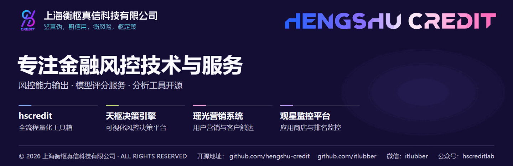

  <picture>
    <source media="(prefers-reduced-motion: reduce)" srcset="https://raw.githubusercontent.com/hengshu-credit/.github/main/profile/assets/banner-static.png?v=20261113-1">
    <source type="image/svg+xml" srcset="https://raw.githubusercontent.com/hengshu-credit/.github/main/profile/assets/banner.svg?v=20261113-1">
    <source type="image/webp" srcset="https://raw.githubusercontent.com/hengshu-credit/.github/main/profile/assets/banner.webp?v=20261113-1">
    
  </picture>

<h1 align="center">衡枢真信 · Hengshu Credit</h1>

  <strong>专注金融风控技术与服务</strong>

  风控建模 · 智能决策 · 客户营销 · 应用监控

  <a href="https://hengshucredit.com/">官方网站</a> ·
  <a href="https://hscredit.hengshucredit.com/">hscredit 文档</a> ·
  <a href="http://tianshu.hengshucredit.com/">天枢操作手册</a> ·
  <a href="https://hengshucredit.com/contact/">联系与合作</a>

---

**衡枢真信（Hengshu Credit）** 是上海衡枢真信科技有限公司的开源技术组织。
我们关注金融科技中的数据分析、风险决策与业务运营，为风控、算法、研发和运营团队建设可复用的工具与平台。

从数据探索与评分卡建模，到规则配置、客户触达和应用商店监控，我们的项目分别覆盖不同的业务环节。
你可以从一个 Python 工具包开始，也可以按实际需求选择决策、营销或监控平台。

  <a href="#开源项目">开源项目</a> ·
  <a href="#从这里开始">从这里开始</a> ·
  <a href="#联系我们">联系我们</a> ·
  <a href="#参与共建">参与共建</a>

## 交流与关注

<table align="center">
  <tr>
    <th align="center">微信 · itlubber</th>
    <th align="center">微信公众号 · 衡枢风控实验室</th>
  </tr>
  <tr>
    <td align="center">
      
       扫一扫，添加微信交流
    </td>
    <td align="center">
      
       hscreditlab · 回复「入群」
    </td>
  </tr>
</table>

二维码可点击查看原图，也可使用微信扫描或识别图片。

## 开源项目

| 项目 | 关注的问题 | 主要使用者 |
| :--- | :--- | :--- |
| [**hscredit**](https://github.com/hengshu-credit/hscredit) | 如何分析风险、开发模型并形成分析报告 | 风控分析师、策略与模型人员 |
| [**天枢决策引擎**](https://github.com/hengshu-credit/tianshu-decision-engine) | 如何组织规则与数据、执行决策并追踪结果 | 策略人员、业务团队与研发人员 |
| [**瑶光营销系统**](https://github.com/hengshu-credit/yaoguang-marketing) | 如何管理客群、编排营销并开展多渠道触达 | 用户运营、营销与增长团队 |
| [**观星监控平台**](https://github.com/hengshu-credit/appstore_applications_monitoring) | 如何跟踪应用上架状态、关键词排名与商店榜单 | 产品、应用运营与市场分析人员 |

### hscredit · 风控分析与建模

面向金融风控策略和模型人员的 Python 工具包，将数据探索、特征处理、模型开发与报告交付放进熟悉的分析工作流。

- **理解数据**：数据探索、分箱分析、特征编码与筛选，查看变量区分度和稳定性。
- **开发模型**：评分卡与机器学习建模、模型评估、可视化和可解释性分析。
- **交付结果**：规则与策略分析、自动化 Excel 报告，以及可逐步运行的 Notebook 示例。

[查看源码](https://github.com/hengshu-credit/hscredit) · [阅读文档](https://hscredit.hengshucredit.com/) · [Notebook 示例](https://github.com/hengshu-credit/hscredit/tree/main/examples)

### 天枢决策引擎 · 规则配置与决策执行

面向业务与技术团队的可视化风控决策平台，让规则、变量、数据来源和执行记录在同一套工作流程中管理。

- **组织决策要素**：规则项目、变量、名单、模型与函数管理。
- **连接业务数据**：外部 API、外部数据库等数据来源配置。
- **验证与追踪**：规则测试、血缘分析、分流实验、执行日志与账单管理。

[查看源码](https://github.com/hengshu-credit/tianshu-decision-engine) · [前端操作手册](http://tianshu.hengshucredit.com/)

### 瑶光营销系统 · 客群运营与客户触达

面向金融科技与互联网业务的开源、自托管营销平台，围绕客户画像、实时事件和营销流程组织客户触达。

- **理解客户**：统一客户画像、动态客群与事件触发。
- **编排营销**：Campaign、Journey、A/B 实验与频控治理。
- **连接渠道**：围绕邮件、短信、Push、WhatsApp、Telegram、站内消息与 Webhook 等场景建设触达能力。

[查看源码与使用说明](https://github.com/hengshu-credit/yaoguang-marketing)

### 观星监控平台 · 应用商店与排名监控

面向产品、运营与市场分析团队，持续跟踪 Google Play 和 Apple App Store 中的应用、关键词与榜单变化。

- **跟踪应用**：按国家和地区查看应用可用性，追踪上架与下架变化。
- **观察排名**：跟踪目标关键词下的应用排名，查看各地区的商店榜单。
- **回看历史**：对照历史排名与应用记录，了解变化发生的时间和市场。

[查看源码与使用说明](https://github.com/hengshu-credit/appstore_applications_monitoring)

更多工具：[MLRun 中文版](https://github.com/hengshu-credit/mlrun-zh)，关注数据集管理、模型训练部署、特征加工与监控。

## 从这里开始

| 你想完成的工作 | 建议的第一步 |
| :--- | :--- |
| 探索数据、比较分箱、开发评分卡或生成分析报告 | 阅读 [hscredit 文档](https://hscredit.hengshucredit.com/)，再运行 [Notebook 示例](https://github.com/hengshu-credit/hscredit/tree/main/examples) |
| 了解规则配置、变量管理和决策执行流程 | 从 [天枢操作手册](http://tianshu.hengshucredit.com/) 开始，部署说明见[项目仓库](https://github.com/hengshu-credit/tianshu-decision-engine) |
| 规划客群运营、营销活动与多渠道触达 | 查看[瑶光营销系统](https://github.com/hengshu-credit/yaoguang-marketing)的项目介绍与部署说明 |
| 跟踪应用在各地区的可用性与排名变化 | 查看[观星监控平台](https://github.com/hengshu-credit/appstore_applications_monitoring)的功能与使用说明 |
| 讨论业务需求、系统集成或技术合作 | 前往[官网联系页](https://hengshucredit.com/contact/)，或通过下方邮箱与微信联系 |

## 联系我们

欢迎交流风控建模、策略分析、决策引擎、客户运营与开源项目实践，也欢迎带着具体业务场景与我们讨论合作。

| 联系方式 | 入口与说明 |
| :--- | :--- |
| **官方网站** | [hengshucredit.com](https://hengshucredit.com/) |
| **业务与技术咨询** | [打开官网联系页](https://hengshucredit.com/contact/) |
| **电子邮箱** | [hscredit@hengshucredit.com](mailto:hscredit@hengshucredit.com) |
| **微信** | `itlubber`，可搜索微信号或扫描[上方二维码](#交流与关注) |
| **微信公众号** | **衡枢风控实验室**（`hscreditlab`），关注后回复 **入群** 加入技术交流群 |

## 参与共建

- **反馈问题**：在项目已开放的 Issues 中说明版本、使用场景与复现步骤；也可以通过邮箱或微信交流。
- **改进文档**：补充教程、修正文档或完善使用示例，帮助更多人顺利开始。
- **贡献代码**：欢迎提交 Pull Request；具体开发方式和贡献要求请查看对应项目的说明。

各项目的使用与分发条件以其仓库中的许可证为准。

---

  <strong>衡枢真信 · Hengshu Credit</strong> 
  与开发者、风控从业者和业务团队一起，把工具做扎实，把经验沉淀下来。

